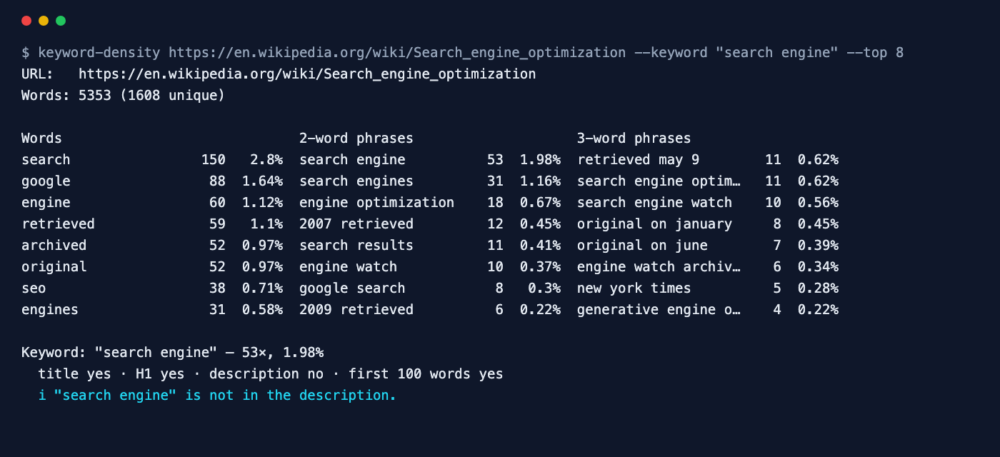

<div align="center">

# Keyword Density Checker

**Find the words and phrases a page is really about — and spot keyword stuffing.**

[](https://github.com/ksanyok/keyword-density/actions/workflows/ci.yml) [](LICENSE)   [](https://promopilot.link/en/tools/keyword-density.php?utm_source=github&utm_medium=repo&utm_campaign=tools&utm_content=keyword-density)

**[▶ Use the free online version — no install, no sign-up](https://promopilot.link/en/tools/keyword-density.php?utm_source=github&utm_medium=repo&utm_campaign=tools&utm_content=keyword-density)**

</div>

`keyword-density` extracts the visible text of a page (or reads an HTML, Markdown or text file), removes stop words and counts the most frequent words and two- and three-word phrases, each with its share of the text. Give it a target keyword and it tells you how often it appears, its density, and whether it is in the title, H1, meta description and the first 100 words — the placements that matter most for on-page SEO.



## What it checks

- Most frequent words, 2-word and 3-word phrases with counts and density (%)
- Visible text only — scripts, styles, comments, navigation markup and entities are handled
- Stop words for English, Ukrainian, Russian, Polish and German (phrases may contain them in the middle, like *cost of living*)
- Target keyword density and a stuffing warning above ~3%
- Target keyword placement: `<title>`, H1, meta description and the first 100 words
- Works on live URLs, saved HTML, Markdown/plain-text drafts and piped text

## Why it matters

Search engines no longer reward repeating a keyword, but frequency still tells you what a page is about — to readers, to Google and to AI assistants. A density report shows whether your draft actually focuses on the topic you are targeting, which related phrases you use naturally, and whether a phrase is repeated so often that it reads as spam. It is also a fast way to see which terms a competing page covers that yours does not.

## Quick start

```bash
# run straight from GitHub, nothing to install
npx github:ksanyok/keyword-density example.com

# or install the CLI globally
npm install -g github:ksanyok/keyword-density
keyword-density example.com
```

Check a draft before publishing:

```bash
keyword-density --file drafts/blue-widgets.md --keyword "blue widgets"
```

Only Ukrainian and English stop words, top 30:

```bash
keyword-density https://example.com/uk/blog/post --lang uk,en --top 30
```

Compare with a competitor:

```bash
keyword-density https://competitor.example/guide --json | jq '.ngrams["2"][:10]'
```

## Example output

```text
$ keyword-density https://en.wikipedia.org/wiki/Search_engine_optimization --keyword search engine --top 8
URL:   https://en.wikipedia.org/wiki/Search_engine_optimization
Words: 5353 (1608 unique)

Words                             2-word phrases                    3-word phrases
search                150   2.8%  search engine          53  1.98%  retrieved may 9        11  0.62%
google                 88  1.64%  search engines         31  1.16%  search engine optim…   11  0.62%
engine                 60  1.12%  engine optimization    18  0.67%  search engine watch    10  0.56%
retrieved              59   1.1%  2007 retrieved         12  0.45%  original on january     8  0.45%
archived               52  0.97%  search results         11  0.41%  original on june        7  0.39%
original               52  0.97%  engine watch           10  0.37%  engine watch archiv…    6  0.34%
seo                    38  0.71%  google search           8   0.3%  new york times          5  0.28%
engines                31  0.58%  2009 retrieved          6  0.22%  generative engine o…    4  0.22%

Keyword: "search engine" — 53×, 1.98%
  title yes · H1 yes · description no · first 100 words yes
  i "search engine" is not in the description.
```

## CLI

```text
Usage: keyword-density <url> [options]
       keyword-density --file article.md|page.html [options]
       cat draft.txt | keyword-density --stdin

Counts the most frequent words and 2- and 3-word phrases in a page or text,
with density in percent, and checks a target keyword's density and placement.

Options:
  -k, --keyword <phrase>  Target keyword to check (density, title, H1, first 100 words)
  --top <n>               Phrases per list (default: 15)
  --min <n>               Minimum occurrences (default: 2)
  --lang <codes>          Stop-word languages, e.g. en,uk (default: all built-in)
  --no-stopwords          Keep stop words
  --file <path>           Analyse a local file (.html is parsed, anything else is plain text)
  --stdin                 Read plain text from standard input
  --json                  Print JSON
  -h, --help              Show this help

Online version (no install): https://promopilot.link/en/tools/keyword-density.php?utm_source=github&utm_medium=cli&utm_campaign=tools&utm_content=keyword-density
```

## Use as a library

```js
import { analyzeUrl, keywordDensity, keywordReport } from '@promopilot/keyword-density';

const r = await analyzeUrl('https://example.com/blog/post', { keyword: 'blue widgets', top: 20 });
console.log(r.totalWords, r.ngrams[1], r.ngrams[2], r.target);

// Plain text
keywordDensity(draft, { ngrams: [1, 2], languages: ['en'] });
keywordReport('blue widgets', { body: draft, title: 'Blue Widgets Guide' });
```

`analyzeUrl(url, options)` and `analyzeHtml(html, options)` return `{ url, lang, title, h1, totalWords, uniqueWords, ngrams: { 1: [], 2: [], 3: [] }, target }`; each n-gram entry is `{ phrase, count, density }`. Options: `ngrams`, `top`, `minCount`, `languages`, `stopwords` (a custom list, or `false`), `keyword`.

## Use in CI (GitHub Actions)

Warn when a content change pushes a keyword into stuffing territory:

```yaml
on: [pull_request]
jobs:
  density:
    runs-on: ubuntu-latest
    steps:
      - uses: actions/checkout@v4
      - uses: ksanyok/keyword-density@v1
        with:
          args: --file content/landing.md --keyword "blue widgets"
```

## How it works

For HTML, comments, `<script>`, `<style>`, `<noscript>` and `<template>` are removed, block-level tags become spaces and entities are decoded. Text is split with a Unicode-aware pattern (`\p{L}` and `\p{N}`) that keeps `e-mail` and `don't` as single words and lowercases everything. N-grams that begin or end with a stop word or consist only of numbers are skipped. Density is `occurrences × words in the phrase ÷ total words`, the same formula most SEO tools use. The page language from `<html lang>` adds its stop-word list automatically.

## CLI vs. online version

| | This package | [Online tool](https://promopilot.link/en/tools/keyword-density.php?utm_source=github&utm_medium=repo&utm_campaign=tools&utm_content=keyword-density) |
|---|---|---|
| Runs on | Your machine, CI, editors | Any browser |
| Input | URL, HTML, Markdown, text, stdin | URL or pasted text |
| Output | Text table, JSON | Visual tables and charts |
| Extras | Custom stop words, library API | Related on-page tools on one site |
| Price | Free, MIT | Free, no sign-up |


## FAQ

<details>
<summary><b>What is a good keyword density?</b></summary>

There is no magic number. Natural texts usually land between 0.5% and 2.5% for their main phrase. Above about 3% the text tends to read as repetitive; below 0.3% the topic may be unclear.
</details>

<details>
<summary><b>Does Google use keyword density?</b></summary>

Not as a ranking formula. It understands topics and synonyms. Density is a diagnostic: it shows focus and catches stuffing.
</details>

<details>
<summary><b>Why are some common words missing?</b></summary>

They are stop words (and, the, для, що…). Use `--no-stopwords` to keep them or `--lang` to choose the lists.
</details>

<details>
<summary><b>Are navigation and footer counted?</b></summary>

Yes, everything in the visible body text counts, as it does for crawlers. To analyse only the article, save it as text and use `--file`.
</details>

<details>
<summary><b>Which languages are supported?</b></summary>

Any language that separates words with spaces. Stop-word lists are built in for English, Ukrainian, Russian, Polish and German, and you can pass your own.
</details>

<details>
<summary><b>Is there a version without installing anything?</b></summary>

Yes — the [online Keyword Density Checker](https://promopilot.link/en/tools/keyword-density.php?utm_source=github&utm_medium=repo&utm_campaign=tools&utm_content=keyword-density) runs the same checks in the browser and explains each result.
</details>

## Related free tools

- [Meta Tag Analyzer](https://promopilot.link/en/tools/meta-analyzer.php?utm_source=github&utm_medium=repo&utm_campaign=tools&utm_content=meta-analyzer) — title, description, canonical, robots and Open Graph
- [SERP Preview](https://promopilot.link/en/tools/serp-preview.php?utm_source=github&utm_medium=repo&utm_campaign=tools&utm_content=serp-preview) — see how a title and description look in Google
- [Schema Validator](https://promopilot.link/en/tools/schema-validator.php?utm_source=github&utm_medium=repo&utm_campaign=tools&utm_content=schema-validator) — check JSON-LD structured data
- [Open Graph Debugger](https://promopilot.link/en/tools/og-debugger.php?utm_source=github&utm_medium=repo&utm_campaign=tools&utm_content=og-debugger) — preview and validate social sharing tags
- [Text Watermark Detector](https://promopilot.link/en/tools/watermark-detector.php?utm_source=github&utm_medium=repo&utm_campaign=tools&utm_content=watermark-detector) — invisible characters and look-alike letters
- [All 120+ free SEO, email and web tools](https://promopilot.link/en/tools/?utm_source=github&utm_medium=repo&utm_campaign=tools&utm_content=keyword-density)

## Contributing

Bug reports and pull requests are welcome — see [CONTRIBUTING.md](CONTRIBUTING.md). Security issues: [SECURITY.md](SECURITY.md).
More docs live in the [wiki](https://github.com/ksanyok/keyword-density/wiki) (sources in [docs/wiki](docs/wiki)).

## License

[MIT](LICENSE) © 2026 Alexandr Krikun

---

<sub>Built and maintained by the team behind [PromoPilot](https://promopilot.link/?utm_source=github&utm_medium=repo&utm_campaign=tools&utm_content=keyword-density) — link building, SEO monitoring and 120+ free tools for site owners. Also on [YouTube](https://www.youtube.com/channel/UCPB8m7BgaexcZh0Vr49ViYA).</sub>
